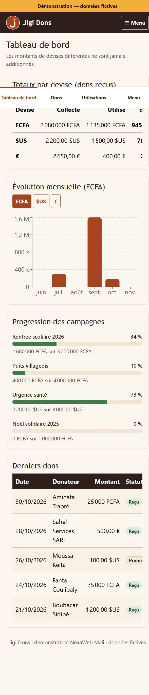
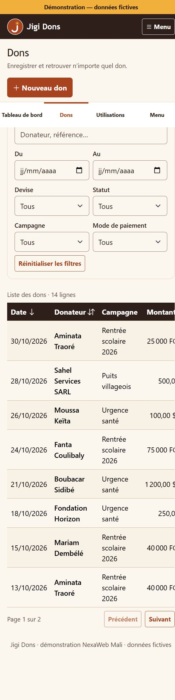

# Jigi Dons — application de suivi de dons

Démonstration réalisée par [NexaWeb Mali](https://aboubacrinebah.github.io/nexawebmali) pour l'Association Jigi
(cahier des charges V2.0). Application web monopage **React + TypeScript strict + Bootstrap 5** qui consomme une
**API Laravel** ; en attendant l'API, elle fonctionne avec une **API fictive en mémoire** (données fictives uniquement).

## Captures d’écran

### Tableau de bord



### Suivi des dons



## Démarrage

Prérequis : Node.js 22.12 ou plus (Vite 8 et Vitest 5).

```bash
npm install
npm run dev        # http://localhost:5173/association-jigi/
npm test           # Vitest + React Testing Library
npx tsc --noEmit   # vérification du typage
npm run lint       # ESLint (a11y, `any` interdit)
npm run build      # build de production dans dist/
```

Comptes de test (mot de passe commun : `demo1234`) : `admin@demo.jigi`, `gestionnaire@demo.jigi`,
`lecteur@demo.jigi`, `donateur@demo.jigi`.

## Brancher l'API Laravel

Copier `.env.example` vers `.env` puis renseigner `VITE_API_URL` (HTTPS obligatoire en production, CORS limité à
`https://aboubacrinebah.github.io`). Sans cette variable, l'API fictive est utilisée.

Le client HTTP (`src/api/http.ts`) suit le contrat du cahier des charges (6.3) :
`/api/auth/login`, `/api/auth/logout`, `/api/me`, `/api/donations`, `/api/donors`, `/api/campaigns`,
`/api/allocations`, `/api/beneficiaries`, `/api/users`, `/api/me/donations`, `/api/stats/summary`.
Hypothèses à confirmer côté Laravel : JSON en **camelCase** ; `POST /api/auth/login` renvoie `{ user, token }` ;
les erreurs de validation (422) renvoient `{ message, errors: { champ: [messages] } }` ; les réponses peuvent
être enveloppées dans `{ data }`. Les montants sont des **entiers dans la plus petite unité** de la devise
(XOF sans décimale, centimes pour USD et EUR).

## Publication GitHub Pages

Dépôt dédié `association-jigi` → `https://aboubacrinebah.github.io/association-jigi/` (`base` de Vite =
`/association-jigi/`, routage par hash). Le workflow `.github/workflows/deploy.yml` construit et publie le site
(Paramètres › Pages › Source : « GitHub Actions »), vérifie la syntaxe et la sécurité des workflows et dépendances,
puis contrôle la disponibilité HTTP et les liens du site publié.

## Structure

```
src/
  types/        interfaces et types (aucun `any`)
  config/       constantes, libellés, navigation par rôle
  utils/        montants, dates, statistiques, CSV
  schemas/      validation Zod des formulaires
  api/          contrat d'API : client HTTP Laravel + API fictive (règles métier et droits)
  context/      React Context : API, session, notifications
  hooks/        useResource, useEntityEditor, usePageTitle
  components/   ui/, forms/, layout/
  views/        une vue par écran de la maquette
```

## Vues et cahier des charges

| Vue | Route | Rôles |
| --- | --- | --- |
| Connexion | `#/connexion` | tous |
| Tableau de bord | `#/` | administrateur, gestionnaire, lecteur |
| Dons, Donateurs, Campagnes, Utilisations, Bénéficiaires, Rapports et exports | `#/dons`, … | administrateur, gestionnaire, lecteur (lecture seule) |
| Utilisateurs | `#/utilisateurs` | administrateur |
| Mes dons | `#/mes-dons` | donateur (ses seuls dons) |

Règles appliquées : solde disponible = dons « reçus » − utilisations, par devise (dons « promis » et « annulés »
exclus) ; refus d'une utilisation supérieure au solde ; montants de devises différentes jamais additionnés ;
progression d'une campagne = dons reçus dans la devise de son objectif ; droits contrôlés par l'API (l'interface
masque en plus les actions interdites) ; isolation des donateurs.

## Hors de cette version

Reçu PDF, taux de change et total consolidé, promesses de dons (le statut existe), journal d'activité, e-mails
automatiques, pièces justificatives : fonctionnalités « souhaitables » ou « optionnelles » du cahier des charges.
La pagination et les filtres des listes sont faits côté client ; les exports CSV sont générés dans le navigateur
(séparateur « ; », encodage UTF-8 avec BOM, lisible par Excel).

## Conventions

TypeScript strict, composants accessibles (WCAG 2.1 AA : navigation clavier, `aria-*`, tableaux avec légende et
`aria-sort`, focus déplacé au changement de vue, lien d'évitement), commits atomiques selon *Conventional Commits*.
